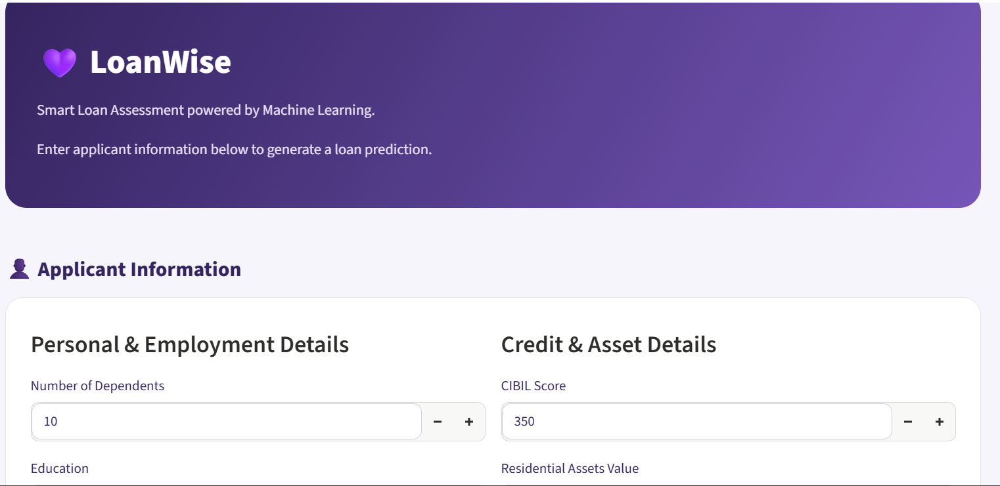
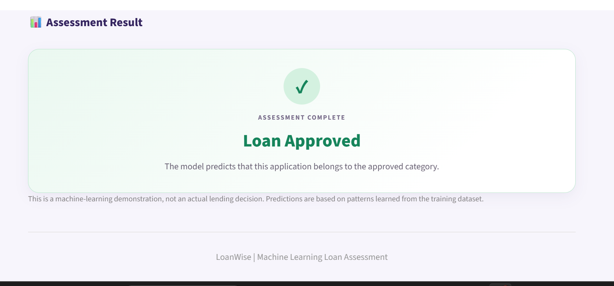
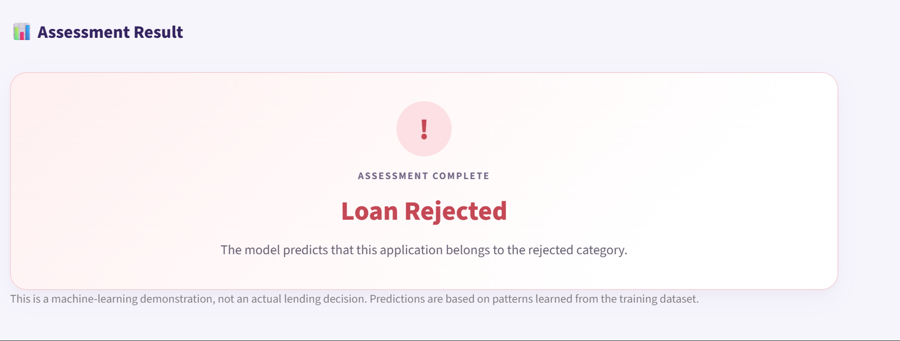

# LoanWise – Loan Approval Prediction System

A machine learning project that predicts whether a loan application is likely to be approved or rejected based on an applicant's financial, credit, and personal information. The project covers the complete machine learning workflow, from data preprocessing and exploratory data analysis to model experimentation, evaluation, error analysis, and deployment through a Streamlit web application.
## Live Demo

[Try LoanWise Here](https://loanwise-predictor.streamlit.app/)

## Project Overview

Loan approval decisions involve evaluating several factors, including an applicant's income, credit history, loan amount, and available assets. The goal of this project was to build a classification model capable of identifying patterns in historical loan application data and predicting loan approval outcomes. The final model is integrated into an interactive web application called **LoanWise**, where users can enter applicant information and receive a prediction.

## 🖥️ Application Preview

### LoanWise Dashboard


### Approved Application


### Rejected Application


## Technologies Used

- **Python** – Core programming language
- **Pandas** – Data manipulation and preprocessing
- **NumPy** – Numerical computations
- **Matplotlib & Seaborn** – Data visualization and exploratory analysis
- **Scikit-learn** – Machine learning, preprocessing, and evaluation
- **Imbalanced-learn** – SMOTE experimentation
- **Joblib** – Model serialization
- **Streamlit** – Interactive web application

## Dataset Description

The dataset contains applicant information and historical loan approval outcomes.

### Features

| Feature | Description |
|---|---|
| `no_of_dependents` | Number of dependents |
| `education` | Applicant's education level |
| `self_employed` | Employment status |
| `income_annum` | Annual income |
| `loan_amount` | Requested loan amount |
| `loan_term` | Loan repayment term |
| `cibil_score` | Applicant's credit score |
| `residential_assets_value` | Value of residential assets |
| `commercial_assets_value` | Value of commercial assets |
| `luxury_assets_value` | Value of luxury assets |
| `bank_asset_value` | Value of bank assets |

**Target variable:** `loan_status`
- Approved
- Rejected

## Project Workflow

### 1. Data Cleaning and Preprocessing
- Inspected the dataset and its structure.
- Handled unnecessary whitespace in column names and categorical values.
- Separated independent variables (`X`) from the target variable (`y`).
- Removed the loan ID column because it was not useful as a predictive feature.
- Encoded categorical variables into numerical representations.
- Applied stratified train-test splitting to preserve class proportions.

### 2. Exploratory Data Analysis (EDA)
Explored relationships between applicant characteristics and loan approval outcomes. Areas of investigation included:
- Distribution of approved and rejected applications.
- Relationship between CIBIL scores and loan approval.
- Influence of income and loan amount.
- Loan terms and asset values.
- Differences in financial characteristics across approval classes.

### 3. Model Experimentation
Explored classification approaches, including:

**Logistic Regression**
- Applied feature scaling using `StandardScaler`.
- Experimented with SMOTE to address class imbalance.
- Examined classification performance.

**Decision Tree Classifier**
Developed and evaluated a Decision Tree model using the original, unscaled features. The final model was configured with:
- **Criterion:** Entropy
- **Splitter:** Best
- **Maximum depth:** 10
- **Minimum samples split:** 10
- **Minimum samples leaf:** 5
- **Random state:** 42

The Decision Tree was selected as the final model for the application.

### 4. Model Evaluation
Evaluated the final model using:
- Accuracy
- Precision
- Recall
- F1-score
- Classification report

**Final Decision Tree Classification Results**

| Metric | Result |
|---|---:|
| Accuracy | 98% |
| Weighted Precision | 98% |
| Weighted Recall | 98% |
| Weighted F1-score | 98% |

The model achieved approximately 98% accuracy on the held-out test set of 854 observations.

### 5. Feature Importance Analysis
Investigated the contribution of individual features to the Decision Tree's predictions. The most influential features were:

| Feature | Importance |
|---|---:|
| CIBIL Score | 78.32% |
| Loan Term | 13.36% |
| Annual Income | 3.34% |
| Loan Amount | 3.21% |
| Residential Assets | 1.19% |

CIBIL score was the most influential feature in the trained model.

### 6. Prediction Error Analysis
Went beyond overall accuracy to investigate incorrect predictions.
- Identified false rejections: applications that were actually approved but predicted as rejected.
- Investigated the CIBIL scores and other financial characteristics of misclassified applicants.
- Identified three false rejections in the test set.

This highlighted the importance of examining individual classification errors rather than relying on accuracy alone.

## LoanWise Web Application

The final Decision Tree model was integrated into a Streamlit application. Users can enter:
- Number of dependents
- Education level
- Employment status
- Annual income
- Loan amount
- Loan term
- CIBIL score
- Residential assets
- Commercial assets
- Luxury assets
- Bank assets

The application processes the information, applies the required categorical mappings, and returns an approval or rejection prediction.

### Application Features
- Interactive applicant information form.
- Automated categorical encoding.
- Consistent model feature ordering.
- Real-time prediction.
- Visual approval and rejection result cards.
- Custom-styled interface.

## Project Structure

```text
Loan_Prediction_Model/
│
├── app.py
├── loan_approval_model.joblib
├── requirements.txt
├── README.md
└── loan_approval_model.ipynb
```

## Running the Application Locally

**1. Clone the repository**
```bash
git clone https://github.com
```

**2. Navigate into the project directory**
```bash
cd loan-approval-prediction
```

**3. Install dependencies**
```bash
pip install -r requirements.txt
```

**4. Run the Streamlit application**
```bash
streamlit run app.py
```

## Key Learnings

Through this project, I strengthened my understanding of:
- Data cleaning and feature preparation.
- Categorical encoding.
- Stratified train-test splitting.
- Logistic Regression and Decision Tree classification.
- Feature scaling and SMOTE experimentation.
- Model evaluation beyond accuracy.
- Feature importance and classification errors.
- Saving and loading machine learning models.
- Integrating trained models into interactive applications using Streamlit.

## Limitations

- The model learns from historical dataset patterns and may not generalize to every real-world lending situation.
- High test accuracy does not guarantee correct predictions for every applicant.
- Feature importance describes the model's learned patterns, not necessarily causal relationships.
- LoanWise is an educational machine learning demonstration and should not be used as the sole basis for actual lending decisions.

## Author

**Joy Anthony Elijah**  
Computer Science Undergraduate | Aspiring AI/ML Engineer  
GitHub:(https://github.com/Idara-Anthony)

---

*Built as part of my journey into Machine Learning and applied AI.*
